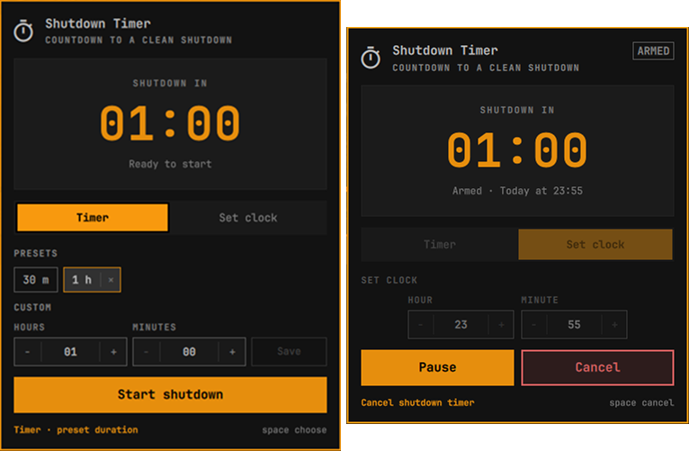

# Shutdown Countdown



An [Omarchy](https://omarchy.org) bar plugin that shuts down the machine after a
countdown. Pick a saved duration or a clock time, start the timer, and the
countdown stays visible in the bar while you work.

- **Duration presets**: 30 minutes and 1 hour by default, plus a custom timer
  with separate hours and minutes fields. Overflow rolls upward
  automatically (120 minutes becomes 2 hours), and durations can span more
  than a day. Save up to ten presets and remove them again from the panel.
- **Set clock**: an hour/minute picker and the countdown above it calculate the
  time remaining. A target that already passed today means tomorrow.
- **Start, pause, resume, cancel**: `Pause`/`Resume` is the filled accent
  action, `Cancel` is the red destructive action, and cancelling returns the
  panel to a single `Start shutdown` button.
- **Survives the panel and the shell while running**: the shutdown is a
  transient systemd user timer, so closing the popup or restarting the shell
  does not lose an armed countdown.
- **Clean shutdown**: when the countdown ends the plugin runs Omarchy's own
  `omarchy-system-shutdown`, which closes applications and shows the OSD.

## Requirements

- Omarchy Quattro (4.x)
- A systemd user session (`systemd-run --user` and `systemctl --user`)

No root access is used. Apart from the transient systemd user timer described
below, the plugin creates no helper files or long-running daemons.

## Install

```bash
omarchy plugin add https://github.com/syaifulmain/omarchy-shutdown-timer.git --enable
```

Pick the bar section when prompted; the default is the right section. If the
widget does not appear after installation, reload the shell:

```bash
omarchy restart shell
```

## Use

Left-click the timer icon in the bar to open the panel. While a countdown is
running, right-click the icon to pause it; right-click again while paused to
resume. Middle-click cancels an active or paused countdown; on an idle timer,
right- and middle-click do nothing.

### Keyboard

Arrow keys or `h`/`j`/`k`/`l` move one shared cursor. Left/Right walk the
current row (the two tabs, the preset chips, the stepper cells, or the action
buttons); Up/Down move between the tab row, the presets, the duration or clock
fields, and the actions. Hovering a control with the mouse moves the same
cursor, so exactly one control is highlighted at a time and the keyboard
continues from wherever the pointer left off. A status line under the actions
names the current target and the keys that act on it.

`Space` or `Enter` activates the current control. `Tab` and `Shift+Tab` move to
the next or previous bar panel, like the other bar widgets. `Escape` closes the
panel. `Delete` or `Backspace` removes the selected preset even when the cursor
is on another control; when the cursor is on a preset, either key removes that
preset instead, and `x` is an alias for the same action. When the panel opens, the
cursor starts on the selected preset (or the current duration/clock value when
no preset exists), and while a shutdown is armed it starts on `Pause` or
`Resume`.

When the cursor is on a stepper's value cell, `Space` starts editing it. Type
the number and press `Enter` to commit and return to navigation; `Tab` or
`Shift+Tab` commits and moves to the next or previous bar panel, and `Escape`
cancels the edit.

### Timer

- Click `30 m`, `1 h`, or another saved preset.
- Or set the duration with the `Hours` and `Minutes` steppers: use `−`/`+`,
  scroll the value field, or click it and type. The hovered `−`/`+` cell uses
  the same accent fill and label color as the primary action, so the active
  cell is obvious. A `−`/`+` that reached its minimum or maximum is disabled
  and is skipped by Left/Right navigation instead of stopping there.
- Values above 59 in the minute field roll upward when committed:
  `120` minutes becomes `2` hours.
- Hours can exceed 24, so multi-day timers are allowed (up to 999 hours).
- `Save` adds the current duration to the preset list. The list is capped at
  ten; at the limit, `Save` shows a maximum-10 warning instead of adding the
  duration.
- Select a preset and use the `×` inside its chip to remove it, press
  `Delete`/`Backspace`, or move the keyboard cursor onto the preset and press
  `x`.

The selected duration is shown in the large clock above the tabs as hours and
minutes; seconds are not shown. Selecting a preset fills the two fields with
that duration; editing either stepper makes the duration custom and updates the
clock immediately.

### Set clock

Choose the target hour and minute with the steppers; the large clock above
shows how long is left in hours and minutes. The `SET CLOCK` section is just
the two inputs, without a separate current-time row or a second explanation
line.

### Theme

The panel is built from Omarchy's `qs.Ui` controls and `Style`/`Color` tokens,
so surfaces, text, accent, and selection colors follow the active Omarchy theme.
Corner rounding follows Hyprland's `decoration:rounding`: rounded themes get
rounded fields and segmented tabs, while a square theme stays square, and nested
controls keep concentric corners.

### Running and cancelling

- `Start shutdown` arms the shutdown timer.
- `Pause` stops the countdown while keeping the time left. `Resume` continues
  from that point; it is the filled accent action so the next step is obvious.
- `Cancel` removes the scheduled shutdown and returns to the single
  `Start shutdown` button. It uses the theme's urgent color with a tinted
  destructive surface, so it cannot be mistaken for `Pause`.
- The bar shows the remaining time while a timer is active: the timer glyph
  stays in place and gains an accent play badge while running, a muted pause
  badge while paused, and turns red in the final minute. On a vertical bar the
  badge sits beside the timer glyph, aligned slightly lower; hover it to see the
  remaining time in the tooltip.

The same actions are available from the shell:

```bash
omarchy-shell syaifulmain.shutdown-countdown status
omarchy-shell syaifulmain.shutdown-countdown start
omarchy-shell syaifulmain.shutdown-countdown pause
omarchy-shell syaifulmain.shutdown-countdown cancel
```

`status` returns JSON with the current phase, remaining seconds, deadline, and
the systemd timer units.

## How scheduling works

Starting a timer creates a transient systemd user timer named
`omarchy-shutdown-countdown-<timestamp>.timer`. It uses a calendar deadline, so the
displayed remaining time and the scheduled shutdown stay in sync across clock
changes and suspend/resume. When the deadline is reached, the timer runs
`omarchy-system-shutdown`.

The timer belongs to the current user session. It is discarded if the session
ends, and a system that is suspended at the deadline shuts down after it
resumes. Restarting the Omarchy shell does not cancel a running timer; the plugin
reads the active unit back with `systemctl --user list-timers`. Pausing stops
that unit, so a paused countdown is forgotten when the shell restarts.

The timer is not a child of the panel. Closing the popup, switching tabs, or
restarting the shell leaves a running timer armed until it fires or is
cancelled.

## Presets and configuration

Presets are stored inline in the widget's entry in
`~/.config/omarchy/shell.json`:

```json
{
  "id": "syaifulmain.shutdown-countdown",
  "presets": [1800, 3600]
}
```

Each value is a duration in seconds. The plugin writes this list through the
shell when you add or remove a preset. It does not create a separate config or
state file.

## Remove

Cancel any armed timer before removing or disabling the plugin. A scheduled
shutdown is an independent systemd unit and will still run after the plugin is
gone or disabled.

```bash
omarchy plugin remove syaifulmain.shutdown-countdown --yes
```

If the panel is unavailable, the unit can be inspected and stopped directly:

```bash
systemctl --user list-timers 'omarchy-shutdown-countdown-*.timer'
systemctl --user stop omarchy-shutdown-countdown-<timestamp>.timer
```

Removing the plugin removes its bar entry, and with it the stored presets. No
other files are left behind.

## Development

Run the model tests with Node.js and validate the plugin folder before
publishing:

```bash
node --test test/
omarchy plugin validate .
```

## License

MIT. See [LICENSE](LICENSE).
